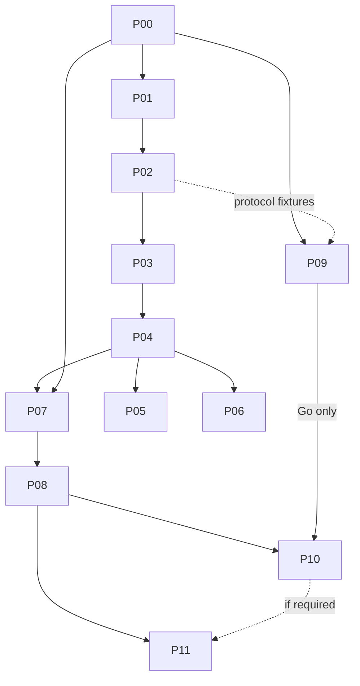

# Engineering Handoff: InfraZero — v2

**Project:** InfraZero  
**Project Type:** Open-source TypeScript Infrastructure Library  
**Architecture:** Browser-first, runtime-agnostic core, local-first, peer-to-peer  
**Development Strategy:** Library-first, Application-driven  
**Primary Reference Application:** PocketDB  
**Secondary Reference Application:** w3dding-frame  
**Runtime Strategy:** Browser first; Node.js headless next; Bare optional and evidence-gated  
**Document Purpose:** Authoritative engineering direction for project decomposition, milestone planning, ticket generation and subsequent implementation  
**Revision Date:** 2026-11-26

## Executive direction for the receiving planning agent

This document supersedes the previous InfraZero handoff. Preserve its extraction-first approach and application boundaries. The intended result is one composable infrastructure SDK, not a new JavaScript runtime, a new database engine or a clone of Pear.

The immediate assignment is to inspect the reference repositories, reconcile this specification with evidence, and translate it into a programme of projects, epics, milestones and implementation-ready tasks. Create a dependency-aware local project board and supporting architecture records. Implementation, external issue/project creation, publication, deployment and upstream repository modifications require their respective authorisation; this specification is not itself authorisation to perform those actions.

**Priority order:** browser MVP → PocketDB compatibility → second application validation → optional modules and browser release → Node.js headless node → Bare feasibility and optional native implementation → cross-runtime orchestration only where justified.

A lightweight Bare feasibility spike may run in parallel with early browser work if it does not delay the browser MVP. Do not make the MVP depend on its outcome. Section 37 defines the planning contract and project map.

---

# 1. Mission

Build InfraZero, a composable infrastructure library for developing distributed applications without requiring dedicated backend deployment.

InfraZero should allow browsers and, eventually, compatible native runtimes to participate in a distributed infrastructure network, where individual nodes can provide and consume networking, storage, state synchronisation, computation and application-defined services.

The framework should enable developers to build applications that traditionally require backend infrastructure while retaining the simplicity of static website deployment.

### Vision

**Your browser is the infrastructure.**

Longer-term vision: **Your devices are the infrastructure.** The browser remains the zero-install entry point; compatible native nodes can be added when the workload needs persistent execution, native resources or stronger operational control.

### Core proposition

Distribute applications through the web, establish communication through peer-to-peer networking, and execute infrastructure services locally on participating devices.

InfraZero is a library and infrastructure foundation, not a database product, cloud management platform or end-user application. Its distinguishing product principle is **progressive infrastructure**: start with a static website and no user-managed backend; add optional peers, native processes and services only when needed. Native execution must not silently become a requirement of browser applications.

---

# 2. Relationship with PocketDB

PocketDB is an existing browser-native database application:

https://github.com/cenzwong/PocketDB

PocketDB already implements several infrastructure capabilities that are directly relevant to InfraZero, including:

- WebRTC transport
- Transport abstractions
- Peer discovery
- Signaling
- Versioned communication protocols
- Message encoding and decoding
- Cryptographic peer authentication
- Invitation-based access
- Remote request dispatching
- Worker-based execution
- Browser-local persistence
- Yjs replication
- Browser and Node.js client integration
- Transport and browser integration tests

InfraZero must not unnecessarily reimplement these capabilities from scratch.

Instead, the project should follow an extraction-oriented development strategy:

**Extract → Generalise → Validate → Reuse**

PocketDB should serve three roles:

1. **Source repository:** A donor of existing infrastructure implementations.
2. **Architectural reference:** Evidence of practical requirements and previously resolved engineering problems.
3. **Reference consumer:** The first substantial application intended to consume InfraZero.

The long-term dependency direction must be:

```text
PocketDB
    |
    v
InfraZero
    |
    v
Browser and Runtime APIs
```

InfraZero must never depend on PocketDB.

PocketDB should remain an independently developed database product.

---

# 3. Instructions for Repository Acquisition

Before designing or implementing the new library, acquire and inspect the PocketDB repository.

```bash
mkdir -p reference

git clone \
  https://github.com/cenzwong/PocketDB.git \
  reference/PocketDB
```

Record the exact source revision:

```bash
git -C reference/PocketDB rev-parse HEAD
```

Also inspect the existing peer-to-peer photo frame application:

```bash
git clone \
  https://github.com/cenzwong/w3dding-frame.git \
  reference/w3dding-frame
```

Reference repositories should be treated as development inputs, not runtime dependencies.

Do not commit entire cloned repositories into InfraZero.

Add the reference directory to `.gitignore`.

The agent is expected to:

1. Read existing architecture documentation.
2. Inspect source implementations.
3. Inspect existing tests.
4. Identify reusable code.
5. Identify application-specific coupling.
6. Identify unresolved defects and technical limitations.
7. Extract suitable implementations into InfraZero.
8. Preserve relevant regression tests.
9. Generalise interfaces only where necessary.
10. Record the source and rationale of extracted components.

Do not modify or push changes to the original PocketDB or w3dding-frame repositories without separate authorisation.

Local integration experiments and migration prototypes are permitted.

If a reference repository cannot be accessed, document the blocker and distinguish newly implemented components from extracted components.

---

## 3.1 External reference research: Pear and Bare

Use the following as architectural references, not additional donor repositories or mandatory dependencies:

- Pear platform: https://pears.com/ and https://docs.pears.com/
- Bare runtime: https://docs.pears.com/bare/ and https://github.com/holepunchto/bare
- P2P building blocks: https://docs.pears.com/p2p/reference/
- Hyperswarm: https://github.com/holepunchto/hyperswarm
- Hypercore: https://github.com/holepunchto/hypercore
- Hyperbee: https://github.com/holepunchto/hyperbee
- Hyperdrive: https://github.com/holepunchto/hyperdrive
- Autobase: https://github.com/holepunchto/autobase

Pear illustrates a modular native P2P platform; Bare is its underlying modular JavaScript runtime. The P2P building blocks may also be used independently of Pear, including in compatible Node.js applications. Do not equate adopting Bare with adopting Pear, or adopting Hyperswarm with adopting Bare. Do not adopt Pear application distribution, OTA updates or its URI scheme merely because they exist.

Review pinned dependency versions, licences, runtime requirements, release activity and API compatibility before recommending adoption. Record findings in `docs/research/PEAR-BARE.md`. The official documentation was consulted for this handoff; no native integration was executed or benchmarked.

# 4. Existing PocketDB Reference Material

Inspect at least the following files and packages.

## Architecture and project decisions

```text
README.md
PROJECT.md
AGENTS.md

docs/architecture/README.md
docs/handoff.md
docs/specs/protocol-v1.md
docs/specs/remote-access.md
docs/specs/hosted-runtime.md

docs/decisions/
```

## Infrastructure implementations

```text
packages/transport/
packages/protocol/
packages/remote-access/
packages/runtime/
packages/client/
packages/node-client/
packages/engine-yjs/
```

## Existing verification infrastructure

```text
packages/transport/test/
packages/transport/testing/

packages/protocol/test/

packages/remote-access/test/

packages/runtime/test/

packages/engine-yjs/test/

tests/two-container-peers/
tests/package-release/

apps/web/test/
```

## Project board

```text
board/backlog/
board/blocked/
board/done/
board/archive/
```

Pay particular attention to:

- ADR-005: WebRTC transport
- ADR-006: Signaling and NAT
- ADR-007: Protocol encoding
- ADR-008: Capability authentication
- ADR-009: Browser persistence
- ADR-010: Worker execution
- ADR-013: CRDT synchronisation
- ADR-016: Package distribution and versioning
- ADR-019: Defer general infrastructure service contracts

ADR-019 is especially important.

It records the decision to avoid introducing a broad infrastructure service abstraction directly into PocketDB without sufficient evidence from independent services.

InfraZero should respect that decision by establishing a separate infrastructure library rather than expanding PocketDB into a general-purpose infrastructure platform.

However, InfraZero must still avoid premature abstractions.

---

# 5. Extraction Strategy

## 5.1 Component extraction matrix

| PocketDB Component | InfraZero Action |
|---|---|
| Transport contracts | Extract and reuse |
| WebRTC Data Channel implementation | Extract and reuse |
| In-process transport | Extract and reuse |
| Transport contract tests | Extract and reuse |
| Discovery contracts | Extract and generalise |
| HTTP signaling adapter | Extract as an optional compatibility adapter |
| Message codec | Extract and remove database-specific coupling |
| Protocol envelopes | Separate generic communication from database semantics |
| Cryptographic identity | Extract reusable cryptographic primitives |
| Peer authentication | Extract reusable mechanisms after security review |
| Invitation handling | Generalise into scoped peer and service invitations |
| Remote request dispatcher | Extract reusable request-handling mechanisms |
| Worker request lifecycle | Extract reusable execution mechanisms |
| Yjs replication | Generalise authenticated state synchronisation |
| Yjs persistence | Extract where independent of database-specific semantics |
| Database runtime | Retain in PocketDB |
| PGlite engine | Retain in PocketDB |
| SQLite engine | Retain in PocketDB |
| DuckDB engine | Retain in PocketDB |
| KV database engine | Retain in PocketDB |
| Database permissions | Retain in PocketDB |
| PostgreSQL and RESP bridges | Retain in PocketDB |
| Database MCP server | Retain in PocketDB |
| Database UI | Retain in PocketDB |

The extraction matrix is an initial hypothesis. Validate it against the acquired source revision.

## 5.2 Extraction rules

For each extracted component:

1. Identify its original responsibility.
2. Identify its dependencies.
3. Identify PocketDB-specific assumptions.
4. Preserve its observable behaviour where appropriate.
5. Extract the relevant implementation.
6. Extract its associated tests.
7. Remove unnecessary database dependencies.
8. Introduce the smallest necessary generic interface.
9. Validate the extracted component independently.
10. Validate its use in a reference application.

Do not copy an entire package when only a small portion is reusable.

Do not replace a tested implementation with a newly generated implementation merely to improve naming or code aesthetics.

## 5.3 Provenance and licensing

Verify the license of the acquired source revision.

PocketDB currently declares Apache-2.0 licensing. Preserve applicable copyright notices, attribution, license obligations and third-party notices.

Maintain:

```text
docs/EXTRACTION.md
```

Each extraction record should include:

- Source repository
- Source commit SHA
- Original file path
- Destination file path
- Extracted functionality
- Modifications made
- Associated tests
- License considerations
- Remaining limitations

---

# 6. Technology Foundation

The following technologies establish the InfraZero ecosystem direction.

```text
InfraZero
│
├── GitHub Pages  → Application Distribution
├── WebRTC        → Network Transport
├── Trystero      → Primary Discovery
├── PeerJS        → Alternative Discovery
├── Yjs           → Distributed State
├── OPFS          → File Storage
├── IndexedDB     → Local Persistence
├── PGlite        → Database Integration
├── WebAssembly   → Compute
├── Web Workers   → Execution Isolation
├── WebGPU        → AI Acceleration
└── Web Crypto    → Identity & Security
```

Not every technology must be included in the core library.

Distinguish between infrastructure primitives, optional integrations and deployment targets.

| Technology | Responsibility | Placement |
|---|---|---|
| WebRTC | Network transport | Infrastructure foundation |
| Trystero | Peer discovery and connection management | Optional adapter |
| PeerJS | Peer discovery and connection management | Optional adapter |
| Web Crypto | Identity and cryptographic primitives | Core infrastructure |
| Yjs | Distributed state | Optional module |
| OPFS | Local file storage | Optional module |
| IndexedDB | Local persistence | Optional module |
| Web Workers | Background execution | Optional module |
| WebAssembly | Portable computation | Optional module |
| WebGPU | Hardware-accelerated computation | Optional module |
| PGlite | Embedded relational database | Reference integration |
| SQLite | Embedded relational database | Reference integration |
| DuckDB | Analytical computation | Reference integration |
| GitHub Pages | Static application hosting | Reference deployment target |

PGlite, SQLite, DuckDB and other database engines must not become mandatory dependencies of InfraZero. Keep their implementations in PocketDB or separately justified reference integrations; do not create a second database product.

## 6.1 Optional native technology candidates

| Technology | Potential role | Status |
|---|---|---|
| Node.js | First headless host; reuse existing PocketDB Node-client knowledge | Planned after browser foundation and application validation |
| Bare | Lightweight embeddable native runtime | Candidate; adoption gated by compatibility spike |
| `bare-fs`, `bare-crypto`, `bare-thread`, other Bare modules | Native platform capabilities | Evaluate only required modules; verify APIs and semantics |
| Hyperswarm / HyperDHT | Optional native discovery and encrypted transport | Separate adapter, not default browser networking |
| Hypercore / Corestore | Append-only replication and storage management | Research, not a replacement for Yjs |
| Hyperbee / Hyperdrive | Optional native KV/filesystem-oriented integrations | Research, not mandatory core dependencies |
| Autobase | Multiwriter log-based state | Research, with explicitly distinct semantics from CRDTs |
| Pear distribution / OTA | Optional native application distribution | Out of initial scope; requires independent justification |

A native module must earn its place through a concrete workload, compatibility tests and a documented ownership/maintenance plan.

---

# 7. Architectural Principles

## 7.1 Library-first

InfraZero should primarily be distributed as a developer library.

It should provide:

- TypeScript APIs
- Independently importable modules
- Stable public interfaces
- Extension mechanisms
- Reference implementations
- Test utilities
- Developer documentation

A browser-based playground may be provided, but the playground must consume the public library.

Do not make a management console the central architecture.

## 7.2 Application-driven Development

New abstractions should be justified by concrete application requirements.

PocketDB and w3dding-frame represent two distinct reference workloads:

- Remote database execution
- Remote control and binary asset distribution

Use these applications to validate whether an infrastructure abstraction is genuinely reusable.

## 7.3 Zero User-managed Backend

Applications should be deployable through static hosting without requiring developers to provision a dedicated backend.

Public signaling services, STUN servers and TURN relays are permitted.

Zero-deployment does not mean zero external infrastructure dependencies.

External dependencies must remain explicit, configurable and observable.

## 7.4 Local-first

Participating nodes should retain local ownership of their data.

Where appropriate, applications should continue operating offline and synchronise when connectivity is restored.

## 7.5 Composability

Applications must be able to use individual infrastructure modules independently.

For example:

- Networking without Yjs
- Yjs without a remote database
- RPC without WebGPU
- Local storage without a P2P network
- Compute without distributed state

Avoid loading unnecessary WASM runtimes, AI models or database engines.

## 7.6 Pluggability

External libraries should be encapsulated behind narrow, practical interfaces.

A developer should be able to change the network adapter without rewriting application-level business logic.

## 7.7 Progressive Complexity

Prefer simple, working implementations before introducing sophisticated orchestration.

Do not introduce distributed consensus, automatic failover, service meshes or universal resource schedulers without demonstrated requirements.

## 7.8 Runtime Portability

The initial runtime target is the browser.

Where practical, keep protocol, authentication and transport contracts independent of browser-specific globals.

Future Node.js or native integrations should be possible without redesigning the entire library.

## 7.9 Browser-first, runtime-agnostic, progressive infrastructure

- Browser is the default supported deployment and must remain usable without native installers, companion processes or a user-managed backend.
- Shared protocol, RPC, transport contracts, service semantics and lifecycle logic should use portable TypeScript. Runtime-only dependencies are injected or isolated at explicit entry points.
- Use capability detection rather than assuming that a runtime name guarantees a feature. Unsupported features fail explicitly; do not silently downgrade security or durability.
- Runtime adapters and network/storage/execution providers are independent axes. A Node.js node can use WebRTC or Hyperswarm if supported; a Bare node is not necessarily a Pear application.
- Native nodes are optional peers, not privileged central controllers. Existing browser-only deployments must continue to work without them.
- No `window`, `document`, OPFS, Node builtins or Bare globals in runtime-neutral modules unless mediated by a documented portable boundary. Browser bundle tests must catch native dependency leakage.
- Introduce only the minimal platform interfaces needed by concrete modules. Do not build a universal runtime abstraction upfront.

Prefer one shared SDK with explicit runtime entry points to multiple incompatible forks.

---

# 8. Target Architecture

```text
Applications: PocketDB | w3dding-frame | other reference workloads
                              |
                        Public SDK
                              |
       +---------------- InfraZero Core ----------------+
       | Node lifecycle | Protocol | RPC | Events       |
       | Identity contracts | Pairing | Service registry|
       +----------------------+-------------------------+
                              |
      Independently composable providers and runtime adapters
                              |
     +------------------------+-------------------------+
     |                        |                         |
 Browser (default)       Node.js (headless)        Bare (optional)
 WebRTC / Trystero       Verified WebRTC           Verified transport
 PeerJS                  Optional Hyperswarm       Optional Hyperswarm
 Web Crypto              Crypto provider           Crypto provider
 OPFS / IndexedDB        Native filesystem         Native filesystem
 Workers / WASM          Worker/execution adapter  Thread/worker adapter
 WebGPU (optional)       Optional native compute   Optional native compute
     |                        |                         |
     +------------------------+-------------------------+
                   Operating system / device
```

The columns are deployment profiles, not inseparable provider bundles. Lines do not imply automatic connectivity between runtimes or transports.

## 8.1 Architectural boundaries

| Layer | Owns | Must not own |
|---|---|---|
| Runtime-neutral contracts | Lifecycle, transport, crypto/storage/execution boundaries | Platform-specific implementations |
| Protocol and communication | Framing, codec, request correlation, RPC, errors | Database semantics or runtime globals |
| Runtime adapter | Platform services, lifecycle hooks, capability detection | Application permissions or business logic |
| Network provider | Discovery/signaling and transport implementation | Implicit service authorisation |
| Optional modules | State, storage, transfer, workers, compute | Mandatory core dependency or automatic remote exposure |
| Application | Business logic, database permissions and UI | Reimplementation of validated infrastructure primitives |

Dependencies must flow from applications and adapters toward stable shared contracts. Optional modules must not become mandatory core dependencies. Use explicit package entry points and prevent cyclic dependencies. An initial implementation may co-locate modules in fewer packages; these are logical boundaries, not a requirement to create empty scaffolding.

## 8.2 Capability and configuration model

Separate `runtime`, `network`, `identity`, `storage`, and `execution` configuration. The public SDK should report capabilities such as durable-local-storage (with documented caveats), native filesystem, supported transports, execution isolation, availability mode and maximum message size. Capability advertisements describe what a node can do, not what another peer may invoke.

Illustrative configuration (not an existing API):

```typescript
const node = await createNode({
  name: "my-laptop",
  runtime: browserRuntime(),
  network: trystero({ room: "hackathon-team" })
});
await node.start();
```

Future headless configuration should preserve the same application-facing semantics where the capability is supported. Never require installing a native runtime to import the browser SDK.

---

# 9. Core Infrastructure Node

An InfraZero Node represents a participating runtime.

Each node may act as both a service provider and consumer.

A node should progressively support:

- Persistent cryptographic identity
- Human-readable name
- Network configuration
- Peer connections
- Connection lifecycle
- Registered RPC methods
- Local events
- Remote events
- Service advertisements
- Runtime capability detection
- Optional infrastructure modules
- Graceful shutdown

Example proposed API:

```typescript
import { createNode } from "@infrazero/core";
import { trystero } from "@infrazero/network-trystero";

const node = await createNode({
  name: "my-laptop",
  network: trystero({
    room: "hackathon-team"
  })
});

await node.start();
```

The API examples throughout this document are illustrative rather than mandatory final interfaces.

The receiving agent should refine them based on implementation evidence.

---

## 9.1 Optional headless node

A headless node is a normal InfraZero peer operated as a long-running local process. It may host explicitly configured services, provide persistence, execute registered computations or participate in state synchronisation. It is not automatically a replica, backup, leader or relay for other nodes.

Proposed interface: `infrazero node start --config <path>`, with documented foreground mode, graceful termination, status/diagnostics, explicit identity persistence and resource limits. Configuration must not contain default public service exposure, embedded production secrets or automatic port forwarding. Native service installation and mobile embedding are separate decisions.

A browser going offline does not transfer its service or data ownership to a headless node. An always-on node provides availability only for services and data explicitly hosted or replicated there. Demonstrate that distinction in examples and tests.

# 10. Network Layer

## 10.1 Transport abstraction

Start by examining the existing PocketDB transport contracts:

```text
packages/transport/src/contracts.ts
```

PocketDB already defines interfaces for:

- Transport connections
- Transport adapters
- Message delivery
- Connection state
- Transport errors
- Connection lifecycle

Preserve these useful boundaries.

A possible common connection contract is:

```typescript
interface TransportConnection {
  readonly peerId: string;
  readonly state: TransportState;
  readonly maxMessageBytes?: number;

  send(data: Uint8Array): Promise<void>;

  disconnect(reason?: string): Promise<void>;

  onMessage(handler: MessageHandler): Unsubscribe;

  onStateChange(handler: StateHandler): Unsubscribe;
}
```

Extend the transport abstractions only where necessary to support incoming connections, room membership and multiple peers.

## 10.2 Separate transport from discovery

Maintain a conceptual distinction between:

```text
Transport  → Deliver messages
Discovery  → Find peers
Signaling  → Establish connections
Identity   → Verify peers
```

Trystero and PeerJS may combine multiple responsibilities internally.

InfraZero should normalise their observable behaviour without unnecessarily duplicating their internal functionality.

## 10.3 Trystero adapter

Trystero should be the preferred adapter for room-based, multi-peer applications.

Reference:

https://github.com/dmotz/trystero

Expected capabilities:

- Room-based discovery
- Peer join and leave notifications
- Direct peer messaging
- Broadcast messaging
- Binary data exchange
- Configurable signaling strategies
- Connection lifecycle management

Inspect the actual supported APIs of the selected dependency version before implementation.

Do not assume that every proposed capability is available in every Trystero version.

## 10.4 PeerJS adapter

PeerJS should remain a first-class alternative.

Reference:

https://github.com/peers/peerjs

Expected capabilities:

- Explicit Peer ID connections
- Direct point-to-point communication
- Incoming connection handling
- Binary data exchange
- Configurable PeerServer
- Configurable ICE infrastructure

Use w3dding-frame as a reference for simple PeerJS integration.

## 10.5 Native WebRTC adapter

Extract the existing PocketDB WebRTC transport and retain it as a lower-level adapter.

This is useful for:

- Existing PocketDB compatibility
- Explicit signaling control
- Custom connection establishment
- Security-sensitive connection binding
- Testing
- Future runtime integrations

The native WebRTC adapter must not require Trystero or PeerJS.

## 10.6 Adapter interoperability

Do not assume nodes using different adapters can automatically connect.

A compatible communication protocol does not imply compatible discovery or signaling.

Cross-adapter gateways are a future capability rather than an MVP requirement.

## 10.7 Network reliability

Provide or progressively introduce:

- Connection timeouts
- Reconnection
- Cancellation
- Backpressure
- Message size limits
- Heartbeats
- Connection diagnostics
- Configurable ICE servers
- Direct versus relayed connection information
- Graceful disconnect handling

The library must clearly distinguish successful local message submission from confirmed remote delivery.

---

## 10.8 Native transport and cross-runtime interoperability

The first Node.js headless node should prioritise a browser-compatible WebRTC data-channel transport and a matching signaling strategy. Investigate existing PocketDB Node-client code before selecting another dependency. A candidate Node WebRTC implementation may be evaluated if the existing one is unsuitable; pin versions and test actual browser interoperability.

Hyperswarm/HyperDHT is an optional native transport/discovery candidate for Node.js and/or Bare. Its streams need bounded message framing, backpressure and lifecycle adaptation to InfraZero's transport contract. Do not assume that a Hyperswarm peer can directly connect to a WebRTC peer or that room names, keys and discovery identifiers are interchangeable.

For each transport pair, document the exact supported runtime pair, discovery/signaling path, authentication profile, direct/relayed connectivity and tests. A shared wire protocol is necessary but insufficient for interoperability.

A gateway is explicitly out of MVP scope. If justified later, design it as an opt-in component with separately reviewed trust boundaries, authentication, authorization, routing, end-to-end encryption implications, abuse controls and availability semantics. Never silently proxy traffic or treat a relay as proof of identity.

# 11. Communication Protocol

## 11.1 Protocol extraction

Inspect:

```text
packages/protocol/src/protocol.ts
```

PocketDB already implements:

- Versioned message envelopes
- Typed value encoding
- Binary data encoding
- Structured errors
- Request identifiers
- Payload validation
- Message size limits
- Object nesting limits

Reuse suitable implementation mechanisms.

However, PocketDB's existing protocol contains database-specific concepts such as:

```text
engineId
instanceId
database sessions
database capabilities
```

These concepts must remain outside the generic InfraZero communication protocol.

## 11.2 Generic message model

A proposed generic message envelope:

```typescript
interface InfraMessage {
  version: number;
  id: string;
  type: MessageType;
  namespace: string;
  payload: unknown;
}
```

Potential message types:

```text
HELLO
AUTHENTICATE
REQUEST
RESPONSE
ERROR
EVENT
HEARTBEAT
DISCONNECT
```

The actual protocol should be designed from concrete requirements.

Avoid including unused fields or speculative protocol types.

## 11.3 Protocol guarantees

Define:

- Version negotiation
- Request correlation
- Validation rules
- Encoding rules
- Maximum message sizes
- Error formats
- Cancellation semantics
- Compatibility rules
- Unknown message handling
- Duplicate request handling

Non-idempotent operations must not be automatically retried without an explicit safe retry strategy.

A disconnected or timed-out request may have an unknown execution outcome.

Preserve this distinction from the existing PocketDB implementation.

## 11.4 Protocol compatibility

InfraZero's generic protocol and PocketDB's existing database protocol may coexist.

The initial PocketDB integration may transport existing database protocol messages through InfraZero without immediately migrating to a new RPC protocol.

Do not require a breaking PocketDB wire-protocol migration merely to adopt InfraZero's transport.

---

# 12. Identity and Security

Inspect:

```text
packages/protocol/src/peer-authentication.ts
packages/protocol/src/invitation.ts
```

Existing PocketDB implementations include:

- ECDSA identity
- Public key import and export
- Public key fingerprints
- Authentication challenges
- Capability proofs
- Expiration
- Session authorization
- Revocation checks
- WebRTC certificate fingerprint binding

Reuse existing cryptographic primitives where appropriate.

Separate generic identity from application-specific permissions.

## 12.1 Identity model

InfraZero should distinguish:

```text
Node Identity
    Persistent cryptographic identity

Connection Identity
    Identity associated with a transport session

Service Authorization
    Permission to perform specific operations
```

A display name or PeerJS ID must not be treated as a cryptographic identity.

## 12.2 Pairing and invitations

Support scoped invitations that may include:

- Network connection information
- Expected remote identity
- Allowed services or operations
- Expiration
- Capability information

Secrets must not be placed in publicly distributed static assets.

Invitation sharing mechanisms should avoid unnecessary disclosure through URL logs, referrers or telemetry.

## 12.3 Channel binding

PocketDB's current authentication mechanism uses WebRTC DTLS certificate fingerprints obtained through the underlying peer connection.

This is a significant extraction consideration.

Trystero and PeerJS may expose different levels of access to the underlying WebRTC connection.

The agent must investigate whether equivalent security properties can be preserved across each adapter.

Do not silently remove or weaken channel binding to make an adapter compatible.

Where an adapter cannot satisfy the required authentication guarantees:

- Document the limitation.
- Fail closed for affected security-sensitive operations.
- Retain a compatible native WebRTC path.
- Evaluate a reviewed alternative authentication design before enabling those operations.

## 12.4 Security requirements

Implement appropriate safeguards for:

- Unauthorized peer connections
- Unauthorized RPC invocation
- Replay attempts
- Expired invitations
- Revoked access
- Malformed messages
- Excessive message sizes
- Resource exhaustion
- Excessive request rates
- Untrusted signaling infrastructure

Use established Web Crypto primitives in browsers and reviewed compatible cryptographic implementations in other supported runtimes.

Do not design custom cryptographic algorithms.

---

## 12.5 Cross-runtime security invariants

Keep node identity and connection authentication distinct from transport-specific public keys. Establish whether existing identity encodings, signature algorithms, canonical serialization, challenge transcripts and key persistence can be implemented compatibly on each candidate runtime. Use known-answer fixtures generated from reviewed implementations, and test both signing and verification directions.

A native transport must demonstrate equivalent required security properties through a reviewed channel-binding or authenticated-session mechanism appropriate to that transport. Do not reuse WebRTC DTLS fingerprint logic on a transport that does not provide it. A transport's encrypted connection does not by itself establish InfraZero service authorization.

Threat model native filesystem access, long-running processes, IPC, native addons, service credentials and gateway trust separately. Restrict filesystem paths and default service permissions; do not treat Bare, Node.js, Web Workers or WASM as a security sandbox for untrusted arbitrary code.

# 13. Remote Procedure Calls

InfraZero should provide a lightweight, typed RPC abstraction.

The purpose is to allow application developers to expose functions remotely without implementing WebRTC messaging manually.

## Provider example

```typescript
node.expose("math.add", {
  handler: async ({ a, b }) => {
    return a + b;
  }
});
```

## Consumer example

```typescript
const result = await node.call(
  targetPeerId,
  "math.add",
  {
    a: 10,
    b: 20
  }
);

console.log(result);
```

Expected result:

```text
30
```

The RPC layer should support:

- Request IDs
- Input validation
- Response correlation
- Structured errors
- Authorization context
- Timeouts
- Cancellation
- Bounded concurrency
- Connection failure handling

Streaming and advanced service routing may be introduced later.

Inspect PocketDB's `remote-session-host.ts` and client request lifecycle for reusable mechanisms.

Do not move database session handling into the generic RPC layer.

---

# 14. Messaging and Events

Provide a simple peer-to-peer event mechanism.

Example:

```typescript
node.subscribe("task.completed", event => {
  console.log(event);
});

await node.publish("task.completed", {
  taskId: "task-001"
});
```

Initial messaging capabilities:

- Peer-to-peer messages
- Broadcast messages
- Topic-based subscriptions
- Peer lifecycle events
- Application events

Initial messaging should be explicitly best-effort and non-durable.

Do not claim Kafka-compatible messaging, exactly-once delivery or durable queues.

---

# 15. Service Discovery

InfraZero may allow applications to advertise available capabilities.

Example:

```typescript
node.advertise({
  name: "calculator",
  version: "1.0",
  methods: ["math.add", "math.subtract"]
});
```

Another node may discover the advertised capability:

```typescript
const services = await node.discover({
  name: "calculator"
});
```

A service advertisement may contain:

- Service name
- Service version
- Provider identity
- Available operations
- Capability information
- Availability status

Advertisements should expire or become unavailable when their provider disconnects.

Discovery must not imply authorization to invoke a service.

Do not introduce a universal infrastructure service lifecycle contract before multiple independent implementations demonstrate the need.

The initial implementation may use lightweight capability advertisements and explicit RPC registration.

---

# 16. Distributed State Module

Technology: Yjs

Inspect the existing PocketDB implementation:

```text
packages/engine-yjs/src/replica.ts
packages/engine-yjs/src/replication.ts
packages/engine-yjs/src/persistence.ts
```

Extract reusable mechanisms for:

- State vector exchange
- Incremental updates
- Replica synchronisation
- Connection lifecycle
- Offline persistence
- Reconnection
- Update size validation

Remove coupling to PocketDB-specific engine identities and database authorization models.

Proposed API:

```typescript
import { sharedState } from "@infrazero/state";

const state = await sharedState(node, {
  name: "team-board"
});

const tasks = state.getArray("tasks");

tasks.push([
  {
    title: "Implement prototype"
  }
]);
```

The module should support:

- Multi-writer state
- Offline updates
- Eventual convergence
- Document-level authorization
- Local persistence

Yjs must remain optional.

Do not use Yjs as the universal mechanism for all infrastructure services.

Do not imply that CRDT membership revocation can erase previously replicated data from another device.

---

# 17. Local Storage Module

Provide optional browser-native storage abstractions.

## 17.1 OPFS

Use the Origin Private File System for suitable file-oriented workloads:

- Binary assets
- Datasets
- Application files
- Model weights
- Cached computation results

## 17.2 IndexedDB

Use IndexedDB for suitable structured persistence:

- Metadata
- Node identity
- Configuration
- Key-value data
- CRDT persistence
- Application-specific records

## 17.3 Storage API

A possible local storage interface:

```typescript
const storage = await createStorage({
  backend: "opfs",
  namespace: "application-data"
});

await storage.put("dataset.csv", file);

const result = await storage.get("dataset.csv");
```

Remote storage access should be implemented through explicit RPC exposure and authorization.

Local storage primitives must not automatically expose private files to network peers.

## 17.4 Browser limitations

Account for:

- Storage quotas
- Eviction
- Origin isolation
- Private browsing
- Unsupported APIs
- Browser data deletion
- Persistence permissions

Provide export or backup mechanisms where appropriate.

Do not assume that different static websites or browser origins automatically share storage.

---

## 17.5 Native persistence (later)

Native filesystem providers must be scoped to a configured application data directory and define their crash, durability and atomic-write behavior. Test traversal, unsafe path handling, symlinks where relevant, resource limits, identity persistence and recovery. Do not claim that OPFS, native filesystem storage and Hyperdrive provide identical semantics. Remote storage and replication remain separately authorized, opt-in capabilities.

# 18. Binary Transfer Module

Provide efficient file and binary data transfer between peers.

Use w3dding-frame as a practical reference workload.

The implementation should progressively support:

- Chunked transfer
- Progress reporting
- Backpressure
- Cancellation
- Maximum transfer size
- Integrity verification
- SHA-256 content hashing
- Deduplication
- Resume capability

Content-addressed storage may be introduced where beneficial.

Example:

```typescript
const transfer = await node.transfer(
  targetPeerId,
  file
);

transfer.onProgress(progress => {
  console.log(progress);
});
```

An application should be able to transfer a large file without loading an unbounded number of chunks into memory.

Avoid placing large binary assets directly inside Yjs documents or ordinary RPC control envelopes.

---

# 19. Compute Module

Technology:

- Web Workers
- WebAssembly

Inspect PocketDB's worker execution implementations:

```text
packages/runtime/src/worker-protocol.ts
packages/runtime/src/worker-engine-adapter.ts
packages/runtime/src/engine-worker-host.ts
```

Extract generic mechanisms where appropriate:

- Worker request correlation
- Execution lifecycle
- Cancellation
- Bounded queues
- Worker failure handling
- Structured errors
- Timeout handling

Database-specific worker operations should remain in PocketDB.

InfraZero should eventually support application-registered computation.

```typescript
await node.registerFunction(
  "dataset.transform",
  trustedProcessor
);
```

Remote invocation:

```typescript
const result = await node.compute(
  targetPeerId,
  "dataset.transform",
  input
);
```

Initially, remote computation must be restricted to explicitly registered, trusted functions.

Do not enable arbitrary remote JavaScript or WASM execution.

Web Workers provide execution separation but should not automatically be treated as a complete security sandbox.

---

# 20. AI Acceleration Module

Technology: WebGPU

This is a later-stage optional capability.

The module should eventually support:

- Runtime capability detection
- GPU availability checks
- Model loading
- Local inference
- Embedding generation
- Streaming inference
- Remote invocation
- CPU or WASM fallback where appropriate

Potential applications:

- Browser-hosted inference endpoints
- Remote embedding services
- Distributed image processing
- Agent infrastructure
- Heterogeneous compute networks

Do not require a specific AI runtime in the core library.

Evaluate compatible inference engines based on demonstrated requirements.

Do not load model weights unless an application explicitly enables the corresponding capability.

Distributed inference across multiple devices, model parallelism and distributed training are outside the initial scope.

---

# 21. PocketDB Integration Architecture

PocketDB should remain responsible for:

- Database engine selection
- Database runtime
- Database query semantics
- Transactions
- Database-specific authorization
- Database session management
- Database capabilities
- Database snapshots
- SQL and KV APIs
- CLI
- MCP integration
- PostgreSQL and Redis-compatible bridges
- Database user interface

InfraZero should progressively provide:

- Transport
- Discovery
- Connection lifecycle
- Generic identity
- Authentication primitives
- Generic messaging
- Generic RPC mechanisms
- Optional storage
- Optional Yjs synchronisation
- Worker utilities

Target relationship:

```text
PocketDB
│
├── Database UI
├── Database SDK
├── Database Protocol
├── Database Runtime
├── Database Permissions
├── Database Engines
│   ├── PGlite
│   ├── SQLite
│   ├── DuckDB
│   └── KV
│
└── InfraZero
    ├── Transport
    ├── Discovery
    ├── Identity
    ├── Communication
    ├── State
    └── Worker Utilities
```

## Integration strategy

Use incremental migration.

### Stage A

Replace or adapt PocketDB's transport dependency with InfraZero's extracted transport implementation.

Preserve the existing database protocol.

### Stage B

Integrate additional networking adapters where their security and runtime compatibility have been validated.

### Stage C

Reuse InfraZero identity and communication components where equivalent behaviour can be demonstrated.

### Stage D

Evaluate generic state and worker utilities.

### Stage E

Remove duplicated implementations only after regression tests pass.

The integration must not unnecessarily break:

- Existing PocketDB browser SDK
- Existing invitations
- Node.js clients
- CLI commands
- PostgreSQL bridges
- RESP bridges
- MCP integrations
- Database transaction semantics
- Existing persistent data

A deliberate protocol or API migration requires a separate documented compatibility plan.

The initial InfraZero project should provide a local migration proof or compatibility example. Full upstream PocketDB migration is a separate deliverable.

---

# 22. Reference Applications

## 22.1 Hello Peer

The smallest possible demonstration.

Two browsers join a compatible network and exchange messages.

This must be the first working example.

## 22.2 Remote Calculator

One peer exposes a function.

Another peer invokes it through RPC and receives a result.

Use this to validate generic communication independently of database concepts.

## 22.3 PocketDB Integration

Demonstrate that an existing PocketDB-compatible database runtime can communicate through InfraZero.

Use this to validate that extraction is practical rather than merely architectural.

## 22.4 Remote Photo Frame

Reference:

https://github.com/cenzwong/w3dding-frame

Use this workload to validate:

- Peer discovery
- Remote commands
- File transfer
- Persistent local assets
- Incremental synchronisation
- Reconnection

## 22.5 Collaborative State

Demonstrate multiple peers editing a shared Yjs document, disconnecting and converging after reconnecting.

## 22.6 Remote Compute

Demonstrate a peer exposing a trusted worker-based computation.

## 22.7 Remote AI Inference

Demonstrate a capable peer exposing a browser-hosted inference function.

These should be independently deployable static examples.

---

## 22.8 Headless peer demonstration (post-browser release)

A browser calls a pre-registered function on a Node.js headless peer, using a verified common transport. Restart the headless peer and demonstrate identity/data persistence and reconnection. Show that the service stays available when other browser tabs are closed, without claiming migration of browser-hosted services.

## 22.9 Bare/native feasibility demonstration (conditional)

Run a minimal InfraZero protocol/RPC exchange between two Bare peers using a validated transport, and compare with Node.js where possible. Demonstrate browser-to-Bare connectivity only if an actual compatible transport is verified. A native-only example does not count as browser interoperability.

# 23. Proposed Repository Structure

```text
InfraZero/
├── packages/
│   ├── core/
│   ├── transport/
│   ├── protocol/
│   ├── identity/
│   ├── rpc/
│   ├── runtime-browser/
│   ├── runtime-node/          # later
│   ├── runtime-bare/          # conditional
│   │
│   ├── network-webrtc/
│   ├── network-trystero/
│   ├── network-peerjs/
│   ├── network-hyperswarm/    # conditional
│   │
│   ├── state/
│   ├── storage/
│   ├── transfer/
│   ├── workers/
│   ├── compute/
│   └── testing/
│
├── examples/
│   ├── hello-peer/
│   ├── remote-calculator/
│   ├── pocketdb-integration/
│   ├── photo-frame/
│   ├── shared-state/
│   ├── file-transfer/
│   ├── remote-compute/
│   ├── headless-peer/         # later
│   └── bare-peer/             # conditional
│
├── apps/
│   ├── playground/
│   └── headless-node/         # later
│
├── tests/
│   ├── contracts/
│   ├── integration/
│   ├── browser/
│   ├── security/
│   └── compatibility/
│
├── docs/
│   ├── ARCHITECTURE.md
│   ├── EXTRACTION.md
│   ├── PROTOCOL.md
│   ├── SECURITY.md
│   ├── COMPATIBILITY.md
│   ├── RUNTIMES.md
│   ├── research/
│   ├── planning/             # programme and dependency map
│   ├── CONTRIBUTING.md
│   └── adr/
│
├── board/
│   ├── backlog/
│   ├── ready/
│   ├── in-progress/
│   ├── blocked/
│   └── done/
│
├── .github/
│   └── workflows/
│
├── package.json
├── pnpm-workspace.yaml
├── pnpm-lock.yaml
├── mise.toml
├── tsconfig.json
├── PROJECT.md
├── AGENTS.md
├── LICENSE
└── README.md
```

This is a proposed long-term structure.

Do not create empty packages for speculative capabilities.

Initially, prefer fewer packages with clear internal module boundaries. Split packages when independent dependency, distribution or lifecycle requirements justify doing so.

---

# 24. Engineering Toolchain

Recommended tools:

| Responsibility | Tool |
|---|---|
| Language | TypeScript |
| Package management | pnpm |
| Workspace management | pnpm workspaces |
| Example applications | Vite |
| Unit testing | Vitest |
| Browser testing | Playwright |
| Formatting and linting | Biome or equivalent |
| CI | GitHub Actions |
| Documentation hosting | GitHub Pages |
| Development environment | Mise, optional |

Standard development workflows must remain functional without Mise.

Maintain conventional configuration files.

Avoid unnecessarily introducing Nx, Turborepo or other monorepo orchestration systems.

Prefer simple, portable commands. Node.js may be used as a development/build tool without becoming a browser runtime requirement. Pin Node.js and pnpm in standard project metadata and optionally mirror them in `mise.toml`; pin Bare only when a spike or supported native target requires it. Use separate CI jobs for runtime/platform combinations; do not install Bare in the ordinary browser-only workflow.

---

# 25. Package Distribution

InfraZero should eventually be distributed as npm-compatible packages.

Potential package names:

```text
@infrazero/core
@infrazero/transport
@infrazero/network-webrtc
@infrazero/network-trystero
@infrazero/network-peerjs
@infrazero/rpc
@infrazero/identity
@infrazero/state
@infrazero/storage
@infrazero/transfer
@infrazero/workers
```

Package names are provisional. Verify namespace availability before publication.

An optional umbrella package may offer a simplified entry point:

```typescript
import {
  createNode,
  trystero
} from "infrazero";
```

Individual modules should remain independently importable.

Package distribution requirements:

- TypeScript declarations
- ESM support
- Explicit package exports
- Controlled public APIs
- Compatible dependency declarations
- Semantic versioning
- Changelog
- Package-level documentation
- Published-artifact smoke tests
- Tree-shaking where practical

Do not publish raw workspace-only package references.

Verify that a clean external consumer project can install and use the built package artifacts.

Use explicit browser and native entry points/exports where needed. Verify the actual Bare module resolver and bundling behavior before promising npm package compatibility on Bare. Pack and test from clean consumers, verify that browser imports exclude native modules, and document runtime support per published package.

Do not publish packages or create external repositories without explicit authorisation.

---

# 26. Implementation Roadmap

## Phase 0 — Source Acquisition and Architectural Reconciliation

Tasks:

- Clone PocketDB.
- Clone w3dding-frame.
- Record source revisions.
- Inspect existing implementations.
- Inspect existing tests.
- Review architectural decisions.
- Identify reusable infrastructure components.
- Identify security-sensitive dependencies.
- Produce extraction matrix.
- Establish initial repository structure.
- Produce implementation backlog.

Deliverables:

```text
docs/EXTRACTION.md
docs/ARCHITECTURE.md
docs/SECURITY.md
PROJECT.md
Initial ADRs
Implementation backlog
```

Acceptance criteria:

- Every proposed extraction has an identified source.
- Application-specific responsibilities are distinguished from generic infrastructure.
- Known blockers and unresolved defects are documented.

## Phase 1 — Transport Foundation

Implement:

- Extracted transport contracts
- In-process testing transport
- Extracted WebRTC transport
- Existing signaling compatibility
- Trystero adapter
- PeerJS adapter
- Connection lifecycle
- Transport contract tests

Acceptance criteria:

Two independent browser contexts can exchange messages using each supported adapter under documented conditions.

The deterministic in-process adapter must support automated testing without external signaling services.

## Phase 2 — Minimum Viable Communication

Implement:

- Generic message codec
- Versioned message envelopes
- Cryptographic identity
- Secure pairing
- RPC
- Structured errors
- Request timeouts
- Bounded request handling
- Basic events
- Remote Calculator example

Acceptance criteria:

Two authenticated peers can establish a connection and invoke an explicitly registered remote function.

Unauthorized requests are rejected.

Malformed or oversized messages are rejected.

## Phase 3 — First PocketDB Integration

Implement:

- PocketDB transport compatibility adapter
- Local integration proof
- Existing protocol preservation
- Regression test execution
- Migration documentation

Acceptance criteria:

A PocketDB-compatible host and client can communicate through InfraZero without unnecessary database protocol changes.

The integration demonstrates actual reuse of extracted components.

Existing security properties must be preserved.

This phase must occur before substantial expansion into speculative infrastructure modules.

## Phase 4 — Second Application Validation

Implement:

- Photo frame reference integration
- Remote command handling
- Binary transfer
- Transfer progress
- Integrity verification
- Persistent asset storage where appropriate

Acceptance criteria:

InfraZero successfully supports a second workload that is not database-centric.

Use findings to refine shared infrastructure abstractions.

## Phase 5 — Distributed State and Storage

Implement:

- Generic Yjs integration
- IndexedDB persistence
- OPFS storage
- State synchronisation
- Offline recovery
- Storage export
- Collaborative example

Acceptance criteria:

Independent peers can make concurrent offline changes and converge when reconnected.

Local storage survives normal reloads in supported environments.

## Phase 6 — Compute and Acceleration (optional expansion)

Implement:

- Worker utilities
- Trusted computation registration
- WASM execution integration
- Runtime capability detection
- Remote compute example
- Separate optional WebGPU feasibility/acceleration work, only when justified

Acceptance criteria:

A peer can expose a registered computation and another peer can invoke it remotely.

Unsupported hardware or runtime capabilities are handled explicitly.

## Phase 7 — Distribution and Stabilisation (browser release)

A minimal browser library can be stabilised and prepared for release after Phase 4, with Phases 5–6 separately prepared as optional modules. Do not make compute, WebGPU or native-runtime work a gate for the browser MVP. Establish packaging smoke tests earlier in the roadmap rather than postponing them until this phase.

Implement:

- Package builds
- External consumer tests
- Documentation
- API stabilisation
- Browser compatibility verification
- Static example deployment
- Security review
- Release preparation

Acceptance criteria:

An external application can install and use InfraZero without cloning the InfraZero monorepo.

---

## Phase 8 — Node.js Headless Runtime (planned, post-browser validation)

- Audit existing PocketDB Node-client and native transport compatibility.
- Select and pin a browser-compatible transport and signaling configuration based on evidence.
- Implement the smallest runtime services needed for identity persistence, native storage, lifecycle and optional registered execution.
- Implement a foreground headless CLI, explicit configuration, diagnostics and graceful shutdown.
- Test browser-to-Node RPC in both directions, reconnection, authorization, persistence across restart and operation without any other browser peer remaining online.

Gate: demonstrated browser compatibility, documented security invariants and no browser bundle regressions. Optional service manager installation, daemon packaging and mobile embedding are not mandatory.

## Phase 9 — Bare Feasibility and Optional Native Support

An isolated research spike may begin in parallel with Phase 0–2; implementation and support commitments remain gated and must not block earlier phases.

Spike deliverables: `docs/research/PEAR-BARE.md`, runnable minimal POC, exact versions/platforms, licence inventory, compatibility matrix, benchmark methodology/results and go/no-go ADR. See Section 38 for the test protocol and decision gate.

If approved, implement the runtime adapter and only the network/storage providers proven necessary; keep Hyperswarm as an independent provider. Validate a real native workload and package distribution. If rejected or deferred, retain the portable interfaces and close the spike with recorded reasons; do not create empty or unsupported packages.

## Phase 10 — Cross-runtime infrastructure (conditional)

- Extend runtime/transport pair coverage only for demonstrated use cases.
- Evaluate explicit state replication and capability-based service selection; distinguish service discovery from failover and scheduling.
- Evaluate a gateway only if a required pair cannot share a transport and its trust model is approved.
- Measure failure behavior, availability and operational costs. Do not promise transparent failover, guaranteed uptime or cross-transport interoperability.

Gate: at least one real application requiring the added capability, reviewed design, bounded implementation scope and reproducible end-to-end evidence.

---

# 27. Minimum Viable Library

The first useful InfraZero release should remain deliberately small.

Target capabilities:

```text
InfraZero MVP
│
├── Transport abstraction
├── Native WebRTC adapter
├── Trystero adapter
├── PeerJS adapter
├── In-process testing transport
├── Message codec
├── Identity and secure pairing
├── RPC
├── Connection lifecycle
└── Basic peer events
```

The MVP does not require:

- A database engine
- Yjs
- OPFS
- WebGPU
- WASM computation
- Infrastructure orchestration
- A large management console

These are future modules, not mandatory initial dependencies. The MVP also excludes a Node.js headless daemon, Bare runtime, Hyperswarm, Hypercore, Pear distribution and cross-transport gateways. Existing PocketDB Node-client regression compatibility remains a requirement where relevant; this does not imply a new InfraZero native service runtime.

The MVP must demonstrate that the core library can support real applications.

---

# 28. Testing and Verification

## 28.1 Contract tests

Every networking adapter should be validated against a common contract where applicable.

Test:

- Connection establishment
- Message delivery
- Incoming connections
- Disconnect handling
- Invalid messages
- Binary messages
- Message size limits
- Backpressure behaviour
- Connection timeouts
- Cancellation
- Lifecycle notifications

Reuse existing PocketDB transport contract tests wherever possible.

Document unsupported adapter capabilities rather than pretending every adapter behaves identically.

## 28.2 Unit tests

Cover:

- Protocol encoding
- Protocol decoding
- Message validation
- Identity operations
- Request correlation
- Error handling
- Authorization checks
- Service advertisements
- Resource limits

## 28.3 Integration tests

Cover:

- Multiple peers
- Independent browser contexts
- Same-network connections
- Cross-network connections
- Public signaling integration
- Connection interruption
- Reconnection
- Remote RPC
- Binary transfers

## 28.4 Security regression tests

Cover:

- Invalid invitations
- Expired invitations
- Replay attempts
- Identity mismatch
- Incorrect peer binding
- Unauthorized operations
- Malformed payloads
- Oversized messages
- Excessive requests

## 28.5 Application compatibility tests

Use PocketDB and w3dding-frame reference workloads.

Preserve relevant original PocketDB regression tests.

Do not claim successful physical-device or cross-network verification unless those tests were actually performed.

## 28.6 CI strategy

Separate deterministic tests from tests requiring public infrastructure.

Public relay availability must not make every unit-test run nondeterministic.

Maintain dedicated integration jobs for real signaling and WebRTC connections.

---

## 28.7 Runtime support and interoperability matrix

Maintain `docs/COMPATIBILITY.md` with a row per tested runtime/transport pair. Suggested initial rows:

| Runtime pair | Transport | Target status |
|---|---|---|
| Simulated peers in one process | In-process (test only) | Deterministic contract tests; not a physical or cross-context network |
| Browser ↔ Browser | Native WebRTC | MVP, with documented signaling |
| Browser ↔ Browser | Trystero / PeerJS (same adapter per test) | MVP, security profile explicitly tested |
| Existing PocketDB browser ↔ Node client | Existing validated transport | Preserve compatibility or document blocker |
| Browser ↔ InfraZero Node headless | Compatible WebRTC + signaling | Phase 8 target |
| Node ↔ Node | Selected native transport | Optional, test before support claim |
| Bare ↔ Bare | Selected native transport | Phase 9 spike; conditional |
| Node ↔ Bare | Hyperswarm or another common transport | Conditional, unverified |
| Browser ↔ Bare | Compatible WebRTC or explicit gateway | Unverified, not a release promise |
| Browser WebRTC ↔ native Hyperswarm | Different transports | No direct interoperability assumed |

Track environment, exact versions, OS/architecture, security profile, relay/direct topology, date, test evidence and result (pass, fail, blocked, not tested). Distinguish independent browser contexts from physical devices and genuine cross-network/NAT scenarios. A native runtime capability is not supported merely because compilation passes.

Run unit and wire-format fixtures across supported runtimes; run browser bundle import checks, native packaging smoke tests and cross-runtime security negatives. Benchmark resource usage only under a reproducible and comparable workload.

# 29. Known Extraction Risks

The initial repository review identified several risks requiring further investigation.

## 29.1 Database-specific protocol coupling

PocketDB's existing protocol contains database engine and instance information.

The generic codec may be reusable while the complete protocol envelope is not.

## 29.2 Authentication coupling

Existing authentication uses connection-specific WebRTC certificate fingerprint information.

Trystero and PeerJS compatibility must be verified before migrating security-sensitive workloads.

## 29.3 Existing authentication CI failure

At the reviewed PocketDB revision, TASK-080 documents an intermittent browser authentication failure involving peer binding and signature verification.

Reference:

https://github.com/cenzwong/PocketDB/blob/main/board/blocked/TASK-080-repair-ci-and-export-limits.md

The receiving agent must inspect the latest repository state to determine whether this issue remains unresolved.

Do not inherit an unresolved authentication problem without documenting and testing it.

## 29.4 Existing release gates

PocketDB's project documentation includes outstanding static deployment and physical-device verification requirements.

Review the latest PROJECT.md and task board.

Do not assume that a source implementation has been production-validated simply because it exists.

## 29.5 Browser lifecycle

Background tabs may be suspended or terminated.

InfraZero cannot guarantee permanent node availability.

## 29.6 External network dependencies

Public signaling services may become unavailable or change their policies.

Provide configurable networking strategies and explicit error reporting.

## 29.7 Cross-origin isolation

GitHub Pages does not provide arbitrary server-side response header configuration.

Do not make cross-origin-isolation-dependent features mandatory without validating a compatible deployment strategy.

## 29.8 Over-engineering

The largest architectural risk is building a sophisticated infrastructure framework before validating concrete applications.

PocketDB and w3dding-frame should continuously serve as practical design constraints.

---

## 29.9 Native runtime compatibility and operational risk

Bare is modular and provides compatibility modules, not guaranteed universal Node/npm or browser API compatibility. Validate required APIs, native addons, package resolution, platform builds, cryptographic behavior, transport and maintainability. Evaluate dependency and release risks independently of marketing claims. A native process reduces browser lifecycle restrictions but introduces installation, updates, filesystem privileges, resource management and host failure risks. No claim of lower overhead or higher throughput is valid until measured.

# 30. Non-goals

The initial InfraZero project must not attempt to implement:

- A complete cloud platform
- AWS compatibility
- Kubernetes compatibility
- A complete distributed operating system
- Universal database abstractions
- Distributed SQL
- Global distributed consensus
- Automatic leader election
- Guaranteed high availability
- Transparent cross-adapter interoperability
- Arbitrary remote code execution
- Full PostgreSQL or Redis wire-protocol compatibility
- Distributed model training
- Distributed GPU memory pooling
- A mandatory central infrastructure server
- A general-purpose service marketplace
- A new JavaScript runtime, a Pear clone or mandatory native application distribution
- Mandatory Bare/Hyperswarm adoption or a browser-to-native bridge in the initial release

These capabilities may be considered independently in the future.

They must not block the first useful library release.

---

# 31. Required Architecture Decision Records

Create ADRs covering:

| ADR | Topic |
|---|---|
| ADR-001 | InfraZero as an independent infrastructure library |
| ADR-002 | Extraction from PocketDB |
| ADR-003 | Application and infrastructure boundaries |
| ADR-004 | Browser-native execution |
| ADR-005 | Transport abstraction |
| ADR-006 | Trystero and PeerJS adapter strategy |
| ADR-007 | Native WebRTC compatibility |
| ADR-008 | Generic communication protocol |
| ADR-009 | Identity, authentication and channel binding |
| ADR-010 | RPC and request reliability |
| ADR-011 | Optional infrastructure modules |
| ADR-012 | Package structure and distribution |
| ADR-013 | PocketDB migration compatibility |
| ADR-014 | Yjs distributed state |
| ADR-015 | OPFS and IndexedDB persistence |
| ADR-016 | Worker and compute execution |
| ADR-017 | Static hosting and browser constraints |
| ADR-018 | Browser-first, runtime-agnostic and progressive infrastructure |
| ADR-019 | Runtime/provider boundaries and capability reporting |
| ADR-020 | Node.js headless transport and service lifecycle |
| ADR-021 | Bare feasibility, Node.js comparison and adoption gate |
| ADR-022 | Hyperswarm and optional native transport semantics |
| ADR-023 | Cross-runtime compatibility and gateway trust boundaries (conditional) |

Introduce ADRs when the relevant decisions are made.

Do not prematurely mark unvalidated future designs as accepted.

Each ADR should contain:

- Context
- Decision
- Alternatives
- Consequences
- Validation evidence
- Known limitations
- Reversibility

---

# 32. Success Criteria

InfraZero should eventually demonstrate:

| Metric | Target |
|---|---|
| Mandatory user-managed backend | Zero |
| Mandatory application installation | Zero for browser examples |
| Deployment model | Static hosting |
| Primary networking adapters | Trystero and PeerJS |
| Lower-level networking | Native WebRTC |
| Core communication | Typed RPC and messaging |
| Identity | Cryptographic peer identity |
| Independent applications | At least two |
| First substantial consumer | PocketDB |
| External library consumption | Supported |
| Deterministic automated tests | Supported |
| Public API documentation | Supported |
| Optional module loading | Supported |
| Browser compatibility | Measured and documented |
| External infrastructure dependencies | Explicitly documented |
| Mandatory native runtime for browser examples | None |
| Portable core | Browser build free of native-only runtime imports |
| Headless service continuity | Demonstrated for explicitly hosted services after Phase 8 |
| Bare adoption | Go/no-go/defer supported by recorded POC evidence; no mandatory adoption |
| Cross-runtime compatibility | Explicit matrix; only tested pairs advertised |

Developer experience targets:

- Establish a first working peer connection in under 60 seconds under supported test conditions.
- Expose and invoke a remote function with minimal application code.
- Switch networking adapters without rewriting application business logic.
- Deploy reference applications through static hosting.
- Add infrastructure capabilities through independent modules.

These targets must be verified rather than assumed.

---

# 33. Required Initial Deliverables

The receiving planning agent should first produce the planning artefacts described in Section 37. The following are initial engineering deliverables to schedule, and to implement only when implementation is assigned:

1. An initial InfraZero repository or approved local workspace.
2. A documented extraction inventory.
3. A source-backed architecture gap analysis.
4. Initial architecture decision records.
5. A dependency-aware implementation roadmap.
6. Engineering epics and actionable tickets.
7. An extracted transport foundation.
8. Relevant migrated regression tests.
9. An initial working Hello Peer example.
10. A minimal remote function demonstration.
11. A PocketDB compatibility and migration plan.
12. A clear security compatibility assessment for each adapter.
13. A runtime portability ADR, runtime/provider dependency rules and browser bundle checks.
14. A runtime/transport compatibility matrix distinguishing verified, blocked and untested targets.
15. A separate Bare evaluation project and Node.js headless implementation project, both outside the browser MVP critical path.

Implementation should begin with a thin, working vertical slice.

Do not stop after producing an architecture document if implementation is part of the assigned task.

---

# 34. Instructions for the Receiving Agent

Treat this document as the authoritative initial engineering direction for InfraZero. For the immediate planning assignment, create the project map, dependency graph, epics, milestones and ticket artefacts before implementation. Do not interpret the roadmap as permission to create remote projects, repos, issues, deployments or changes to upstream repositories. If only planning is assigned, stop at a validated plan with evidence and blockers. If implementation is separately assigned, execute the following sequence.

Follow this execution sequence:

```text
Acquire reference repositories
        |
        v
Inspect implementations and tests
        |
        v
Identify reusable components
        |
        v
Record extraction decisions
        |
        v
Extract transport foundation
        |
        v
Validate transport contracts
        |
        v
Integrate networking adapters
        |
        v
Implement minimal secure communication
        |
        v
Validate Hello Peer and RPC
        |
        v
Validate PocketDB integration
        |
        v
Validate second application
        |
        v
Expand optional infrastructure modules / stabilise browser release
        |
        v
Implement Node.js headless peer when assigned
        |
        v
Decide Bare adoption based on independent spike evidence
        |
        v
Add only justified native providers / cross-runtime capabilities
```

The agent must:

- Reuse working code where practical.
- Preserve relevant regression tests.
- Maintain source provenance.
- Avoid unnecessary rewrites.
- Keep application-specific logic outside InfraZero.
- Record architectural decisions.
- Validate implementation claims.
- Document unresolved blockers.
- Prioritise working end-to-end examples.
- Avoid introducing speculative dependencies.
- Preserve security properties during extraction.

When implementation details are unspecified, select the simplest approach consistent with these principles.

Do not ask for decisions that can reasonably be resolved through source inspection, testing or reversible engineering choices.

Document material assumptions and decisions.

---

# 35. Long-term Ecosystem

InfraZero should become a reusable foundation for multiple independently developed applications.

```text
InfraZero
│
├── PocketDB
│   └── Browser-native Database
│
├── w3dding-frame
│   └── Peer-to-peer Remote Display
│
├── PocketStorage
│   └── Potential Distributed File Storage
│
├── PocketCompute
│   └── Potential Distributed Computation
│
├── PocketAI
│   └── Potential Distributed AI Inference
│
└── PocketInfra
    └── Potential Infrastructure Console
```

Future application names are illustrative.

Do not create these applications merely to complete the ecosystem diagram.

Each application should be justified by a concrete use case.

---

# 36. Final Direction

InfraZero is not intended to replace the browser, operating system, JavaScript runtimes or traditional cloud infrastructure.

It is intended to expose infrastructure capabilities through a practical, reusable and composable developer library, starting with modern browsers and progressively supporting compatible native peers. Browser-first remains the default and the principal zero-install deployment experience.

Its fundamental architecture is:

```text
Static Web       → Distribute software
WebRTC           → Connect devices
Trystero/PeerJS  → Discover peers
Web Crypto       → Establish trust
RPC              → Invoke capabilities
Yjs              → Synchronise state
OPFS             → Store files
IndexedDB        → Persist structured data
Web Workers      → Execute background tasks
WebAssembly      → Execute portable computation
WebGPU           → Accelerate computation
```

PocketDB should become the first substantial consumer of this architecture.

The project must evolve through demonstrated application requirements rather than speculative platform complexity.

**Extract what already works.**

**Generalise what is genuinely reusable.**

**Validate the library through real applications.**

**Your browser is the infrastructure.**

**Your devices can extend it.**

---

# 37. Programme, Projects, Epics and Task Planning Contract

## 37.1 Assignment and outputs

The immediate receiving agent is a programme-planning agent. Its task is to convert this handoff into a source-backed, executable engineering plan, not to invent a second architecture or prematurely implement the whole roadmap.

Work locally unless explicitly authorised to create or update remote repositories, project boards or issues. Inspect existing repository conventions before selecting a tracking system. If a project board already exists, reconcile it instead of duplicating tasks. Preserve stable identifiers. Do not create one repository per project; the projects below are logical delivery workstreams within the InfraZero programme unless evidence and a later decision justify splitting repositories.

Required planning artefacts:

```text
docs/planning/PROGRAMME.md          # mission, project hierarchy, scope, gates
docs/planning/DEPENDENCIES.md      # DAG, critical path, parallel work, blockers
docs/planning/MILESTONES.md        # release increments and exit criteria
docs/planning/RELEASE-SCOPE.md      # browser MVP vs optional/native scope
docs/planning/PROJECTS.md          # project charters and owners/roles (TBD if unknown)
docs/planning/RISK-REGISTER.md      # risk, mitigation, owner role, evidence
docs/planning/TASK-INDEX.md        # canonical IDs and status
docs/planning/TRACEABILITY.md      # handoff section -> project/epic/task/test
board/backlog/                    # actionable task markdown
board/ready/                      # tasks whose dependencies are satisfied
board/in-progress/
board/blocked/
board/done/
```

Paths are illustrative and may be reconciled with existing conventions. `docs/EXTRACTION.md`, `docs/ARCHITECTURE.md`, `docs/SECURITY.md`, `docs/COMPATIBILITY.md`, `PROJECT.md`, `AGENTS.md` and ADRs remain required as appropriate to their phases. Do not mark design proposals as implemented or ADRs as accepted without evidence and approval where applicable.

## 37.2 Project map

| ID | Project / delivery workstream | Primary deliverable | Dependencies | Release class |
|---|---|---|---|---|
| IZ-P00 | Discovery, extraction and repository foundation | Pinned source inventory, baseline test report, ADRs, board, toolchain | None | Browser MVP |
| IZ-P01 | Transport and discovery foundation | Extracted contracts, in-process transport, WebRTC, Trystero, PeerJS, Hello Peer | P00 | Browser MVP |
| IZ-P02 | Secure communication and node core | Codec, node lifecycle, identity, pairing, RPC, events, calculator | P01 (codec/identity research can start earlier) | Browser MVP |
| IZ-P03 | PocketDB compatibility | Local integration, wire compatibility, regression evidence and migration plan | P01, P02 as applicable | Browser MVP |
| IZ-P04 | Second application and binary transfer | Photo-frame integration, remote commands, bounded file transfer | P02, P03 | Browser validation/release |
| IZ-P05 | Distributed state and storage | Optional Yjs, IndexedDB, OPFS, offline/convergence tests | P02, P03, P04 | Optional browser modules |
| IZ-P06 | Trusted compute and acceleration | Worker utilities, registered compute, optional WASM/WebGPU | P02, P03, P04; P05 only if needed | Optional browser modules |
| IZ-P07 | Packaging, docs and browser stabilisation | Packed SDK, clean consumer, static examples, compatibility/security release gate | P01–P04 for full browser baseline; early packaging tasks after P00 | Browser release |
| IZ-P08 | Node.js headless runtime | Browser-compatible native peer and persistent service demonstration | P02, P03, P04, browser release gate in P07 | Native extension |
| IZ-P09 | Bare/Pear feasibility and adoption decision | POC, measured comparison, security and licence review, go/no-go ADR | P00; deeper tests require P01/P02 fixtures | Independent research |
| IZ-P10 | Bare runtime and optional native transport | Supported runtime/provider implementation if approved | P08, P09 go decision; applicable contract tests | Conditional native extension |
| IZ-P11 | Heterogeneous infrastructure | Justified cross-runtime use case and verified compatibility | P08; P10 only if use case needs Bare; approved ADR | Conditional future work |

Project names and IDs are planning seeds, not claims that these projects have already been created. P09 must never block browser release. Optional modules may run in parallel once their concrete prerequisites are satisfied. Do not make P05 or P06 mandatory for initial packaging or P08 unless a selected use case actually requires them.

## 37.3 Milestones and exit gates

| Milestone | Exit criteria |
|---|---|
| M0 — Baseline | Reference SHAs, source inspection, licences, test baseline, extraction decisions and dependency-aware board |
| M1 — First vertical slice | Two independent browser contexts exchange messages through extracted transport; deterministic contract tests; Hello Peer |
| M2 — Secure SDK alpha | Authenticated RPC, structured errors, cancellation/timeouts, rejection tests, declared adapter security profiles |
| M3 — PocketDB proof | Existing protocol and security preserved in a local host/client integration; relevant regressions pass or explicitly block compatibility |
| M4 — Second application | Non-database workload validates remote commands and bounded binary transfer; interfaces refined from evidence |
| M5 — Browser library release candidate | M1–M4, clean packed-package consumer, static deployment tests, documented browser/adapter compatibility, security review; no native runtime dependency |
| M6 — Optional browser capabilities | Independent state/storage and trusted-compute releases with scoped acceptance criteria; WebGPU optional |
| M7 — Headless Node | Browser ↔ Node verified RPC, identity/data restart tests, explicit hosting/availability semantics, no browser regression |
| MR — Bare decision | Reproducible POC results and documented go/no-go/defer; can complete independently of M5 |
| M8 — Conditional Bare | MR go, supported native runtime tests and package smoke tests, real application use case; browser interop claimed only if tested |
| M9 — Conditional heterogeneous network | Approved workload, compatible transport or reviewed gateway, failure/security tests and observed limits |

M2 is not the same as a released MVP; M3 and M4 validate reuse before M5. A blocker on any required security property blocks the affected release capability, not unrelated research or deterministic work. A failed optional adapter must be explicitly unsupported rather than reported as complete. Never publish without authorisation.

## 37.4 Dependency graph (logical)



The P00→P07 edge permits early package tooling; the P04→P07 edge represents the browser release gate. P09 has an early research slice and a later compatibility slice, not a hard prerequisite for P02. The receiving agent must generate an acyclic **task-level** graph; project-level edges do not imply that every task in one project must wait for every task in its predecessor. Do not schedule unapproved conditional implementation as committed work.

## 37.5 Epic seeds and required task decomposition

| Project | Suggested epics (decompose into independently verifiable tickets) |
|---|---|
| P00 | Reference acquisition and provenance; baseline and blocker analysis; toolchain/CI; portable boundaries; backlog reconciliation |
| P01 | Contract extraction; deterministic transport; native WebRTC; discovery/signaling adapters; reliability and Hello Peer |
| P02 | Codec and wire protocol; node lifecycle; identity and secure pairing; adapter security assessment; RPC reliability; messaging and calculator |
| P03 | PocketDB transport shim; host/client proof; invitation/channel-binding regression; migration and rollback documentation |
| P04 | Photo-frame discovery and commands; binary streaming/limits; integrity and recovery; independent reference consumer |
| P05 | Yjs sync authorization; offline persistence/convergence; OPFS/IndexedDB; export and quota behavior |
| P06 | Worker lifecycle extraction; trusted computation; WASM integration if useful; capability reporting; optional GPU spike |
| P07 | Package entry points and pack tests; browser dependency isolation; static deployment and browser matrix; docs/security/release readiness |
| P08 | Headless transport selection; native identity and persistence; lifecycle/CLI; browser-native service integration; operational tests |
| P09 | Pear/Bare ecosystem research; dependency audit; portable core spike; native transport spike; benchmarks; adoption ADR |
| P10 | Bare runtime adapter; conditional native provider; security/packaging verification; native reference workload |
| P11 | Cross-runtime requirements; interoperability matrix; optional reviewed gateway; explicit replication/service selection |

These are seeds, not a fully populated backlog. The planner must split discovery from implementation when evidence is missing. Create independent tickets for tests, migration compatibility, docs and security gates where they need separate owners or dependencies; otherwise keep them in the implementation ticket's definition of done. Avoid duplicate work across epics.

## 37.6 Ticket contract

Use stable IDs, for example `IZ-P01-E02-T003`. Preserve IDs once assigned. Each ticket must be executable by an engineer or coding agent without re-reading the entire handoff; include relevant source paths and links. Example structure:

```yaml
id: IZ-P01-E02-T003
project: IZ-P01
epic: IZ-P01-E02
milestone: M1
title: Extract deterministic in-process transport
kind: implementation
priority: P0
status: backlog
depends_on: [] # populate with actual task IDs after repository inspection
blocked_by: []
release_class: browser-mvp
estimate: TBD # after evidence; do not invent committed dates
handoff_refs: [5, 10, 28]
```

Ticket body must include:

- Context and outcome; concrete user/application need.
- Source references: repository, commit SHA, files, relevant ADRs/tests, or an explicit blocker.
- In scope / out of scope; touched boundaries and public API implications.
- Implementation guidance, leaving reversible details to the implementing agent.
- Acceptance criteria in observable terms, including negative/failure cases where relevant.
- Verification commands, expected artifacts, test environment and evidence required.
- Security, compatibility, migration and rollback requirements where applicable.
- Dependencies, blocked-by reasons, risk and estimate/owner role if known.
- Definition of done; docs and provenance updates when applicable.

A research/spike ticket must specify a question, hypotheses/alternatives, experiment, evidence to collect, timebox (proposed, not a commitment) and decision output. It must not predeclare success. A blocked ticket must name the blocker and unblock condition. A conditional ticket must name its go/no-go gate and remain outside the committed MVP scope.

## 37.7 Initial ticket examples (proposed, not existing board items)

| Seed ID | Task | Observable acceptance |
|---|---|---|
| IZ-P00-E01-T001 | Acquire and pin both donor repositories | SHAs, licences, access errors and source paths recorded; reference/ ignored |
| IZ-P00-E02-T001 | Reproduce PocketDB baseline tests and inspect TASK-080 | Commands, versions, outcomes and security blockers recorded; no upstream mutation |
| IZ-P00-E03-T001 | Define portable-core dependency boundaries | ADR draft and import/bundle guard plan; no mandatory native packages |
| IZ-P01-E01-T001 | Extract transport contracts and regression fixtures | Provenance recorded; contract fixtures pass using deterministic adapter |
| IZ-P01-E03-T001 | Extract WebRTC adapter and Hello Peer | Two isolated browser contexts exchange binary/text messages under documented signaling |
| IZ-P02-E03-T001 | Verify channel binding per networking adapter | Security tests and supported/blocked profile matrix; fail closed on inadequate binding |
| IZ-P02-E04-T001 | Implement correlated authenticated RPC | Remote calculator succeeds; unauthorized, oversized, timeout and disconnect cases tested |
| IZ-P03-E01-T001 | Prove PocketDB transport compatibility | Host/client exchange via InfraZero; original wire protocol and relevant regression behavior retained |
| IZ-P04-E02-T001 | Validate bounded photo-frame file transfer | Verified hash, progress, cancellation and bounded buffering in second workload |
| IZ-P07-E01-T001 | Pack browser SDK and install in clean consumer | Consumer builds and runs without monorepo dependencies or native runtime imports |
| IZ-P08-E01-T001 | Select browser-compatible headless transport | Reproducible Browser ↔ Node data-channel and authentication proof, with pinned dependencies |
| IZ-P09-E01-T001 | Compare Bare and Node dependency/runtime support | Pinned matrix and reproducible minimal portable-core experiment; candidate blockers documented |
| IZ-P09-E04-T001 | Decide Bare go/no-go/defer | Evidence-backed ADR, named workload and maintenance/packaging costs |

The planner may adjust these IDs/titles before first publication and must fill actual dependencies. Do not mark these seed tasks as ready or done simply because they appear here.

## 37.8 Definition of ready and done

Ready: outcome and acceptance criteria defined; prerequisites satisfied or explicitly bounded; source evidence available where required; scope and release class clear; security-sensitive design approved before implementation where applicable.

Done: implementation or research artifact exists; required tests have actually run with recorded results; relevant extraction provenance, ADR and docs updated; regressions addressed; package/build behavior verified where relevant; known limitations and unsupported environments explicitly stated; no hidden dependency on a native runtime for browser builds. A failing mandatory security or compatibility gate cannot be waived by marking a task done. A completed research ticket may legitimately conclude no-go.

## 37.9 Planning execution and final report

1. Acquire the reference repositories and inspect existing board/ADR/test conventions. Record access blockers rather than inventing code facts.
2. Map handoff requirements to projects/epics; reconcile with the actual source and existing work.
3. Split work into small, independently verifiable tickets; wire task dependencies, validate no cycles, and identify the browser critical path.
4. Separate research, implementation, migration, release and conditional work. Keep only unblocked tasks in Ready.
5. Record risks, unknowns, owners/roles (TBD when unknown), and estimates as ranges only where there is evidence. No arbitrary delivery dates.
6. Produce the project charters, task files, index, milestones, dependency graph, coverage/traceability and planning summary. Report counts from the generated artifacts, not guesses.
7. Hand off the first ready vertical-slice tasks with commands, acceptance evidence and blockers. Stop at planning unless implementation is assigned.

The final report must identify the critical path, proposed first sprint, parallelizable work, security/compatibility blockers, conditional decisions and any deviation from this handoff. Do not claim tests, commits, remote issues or releases that were not actually produced.

---

# 38. Bare Runtime Evaluation Protocol (Decision Gate)

## 38.1 Research question

Does Bare provide a material, maintainable advantage over Node.js for a specific InfraZero headless, embedded, desktop or mobile workload without compromising browser-first portability, security or developer experience?

Default decision: **defer adoption until evidence supports it**. Bare is not an MVP dependency. Pear is not an implementation dependency. Hyperswarm is evaluated independently as a transport provider available to compatible native runtimes.

## 38.2 Required experiments

| Experiment | Evidence / pass condition |
|---|---|
| A — Portable core | Same protocol codec, request lifecycle and deterministic fixtures run in browser, Node and candidate Bare environment, or incompatible features documented |
| B — Dependencies | Exact versions, licences, module resolution, required builtins/addons, build paths and supported platforms recorded; clean install/bundle proof |
| C — Identity | Reviewed compatible crypto provider, key encoding/persistence and challenge fixtures; cross-runtime signing/verification where claimed |
| D — Transport | Two native peers establish a connection, exchange bounded messages and handle disconnect, backpressure and malformed frames using a selected transport |
| E — RPC and service security | Authenticated registered function succeeds; unauthorized/replayed/malformed requests rejected; session binding reviewed |
| F — Browser interop | Test only if a common WebRTC/signaling path is feasible; otherwise record unsupported, not a silent fallback or mandatory gateway |
| G — Persistence/lifecycle | Restart preserves configured identity/data, shutdown releases resources; filesystem scope and permission behavior verified |
| H — Operational comparison | Comparable Node/Bare measurements with identical workload and versions: install/artifact size, cold start, idle/active RSS, CPU, RPC latency, throughput, error behavior, packaging and maintenance complexity |
| I — Application fit | At least one concrete workload benefits; document why Node.js or browser alone is insufficient, and whether native support merits ongoing maintenance |

Choose small fixtures and repeat measurements under documented hardware, OS, warm/cold state, payload sizes, concurrency and sample count. Do not use unmeasured claims about runtime speed or footprint. Do not conflate native-native success with browser-native interoperability. The browser baseline must still build and run without the candidate dependency.

## 38.3 Decision criteria

- **Go:** required compatibility/security/lifecycle tests pass for a specifically named supported target; benefits justify dependency and maintenance costs; browser build remains unaffected. Approve scoped P10 tasks only.
- **Defer:** potential benefit exists but platform support, dependencies, workload, security review or transport evidence remains incomplete. Record unblock conditions; leave P10 conditional.
- **No-go:** required security/compatibility cannot be achieved within acceptable scope, or Node.js delivers the workload without a meaningful Bare advantage. Keep the SDK portable and avoid adding a supported Bare package.

A native-only Bare adapter may be approved for a native-only workload even if browser interop is unavailable, provided that limitation is explicit and the intended use case does not require it. If browser interoperability is essential, the compatible authenticated path is a hard gate. Any gateway needs its own ADR and approval.

## 38.4 Architecture comparison reference

| Concern | Browser-first InfraZero | Node.js headless | Bare / Holepunch candidates |
|---|---|---|---|
| Distribution | Static web | Optional local package/CLI | Optional native binary or package; Pear distribution separate |
| Discovery/transport | WebRTC, Trystero, PeerJS | Verified compatible WebRTC; optional native transport | Optional Hyperswarm/HyperDHT, other transport only if verified |
| Identity | Web Crypto | Reviewed compatible provider | Reviewed compatible provider; transport key separate |
| Local storage | OPFS/IndexedDB | Scoped filesystem | Scoped filesystem; Hyperdrive only if justified |
| Replicated state | Optional Yjs | Optional compatible state adapter | Hypercore/Autobase research; not automatic Yjs substitute |
| Execution | Workers/WASM | Worker/native process adapter | Bare threads/native modules where validated |
| Availability | Browser lifecycle constraints | Long-running service, subject to host failure | Long-running or embedded service, subject to host failure |

External technical references: [Bare official documentation](https://docs.pears.com/bare/), [Bare source and threat model](https://github.com/holepunchto/bare), [Pear official documentation](https://docs.pears.com/), [P2P module reference](https://docs.pears.com/p2p/reference/), [Bare module reference](https://docs.pears.com/bare/reference/bare/modules/), [MDN WebRTC data channels](https://developer.mozilla.org/en-US/docs/Web/API/WebRTC_API/Using_data_channels). Documentation confirms the separation of Bare, Pear and the P2P modules; it does not establish compatibility with InfraZero. Pin and independently validate specific dependencies.

---

# 39. Revision Notes and Unverified Assumptions

- This revision preserves the donor-repository instructions, extraction matrix, database ownership boundaries, existing protocol/security requirements, browser MVP and application-driven validation strategy from the supplied handoff.
- It makes runtime portability and progressive infrastructure explicit, adds a Node.js headless roadmap, treats Bare as an optional gated candidate, and adds a programme/task planning contract. Project IDs, phase sequencing, package names and milestone gates are proposed planning defaults, not pre-existing repository state.
- The source handoff describes PocketDB and w3dding-frame implementations and historical blockers. This revision did not clone or re-test those repositories; the receiving agent must validate their current revisions before relying on the inventory.
- No runtime interoperability, package availability, performance advantage, physical-device behavior, current donor test result or native security claim was experimentally established in this revision.
- No repositories, project boards, tickets, external issues, package releases or upstream code changes were created by this revision. It is a specification for the agent that will plan those activities.

**Browser-first. Runtime-agnostic. Application-driven. Evidence-gated.**

**Start with zero user-managed infrastructure. Add capable peers only when needed.**
